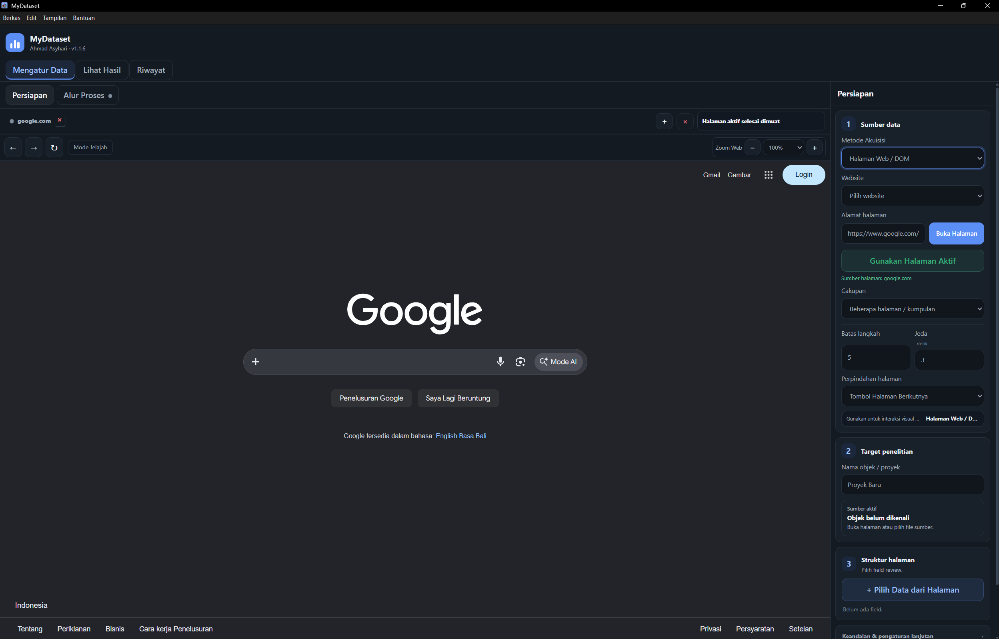
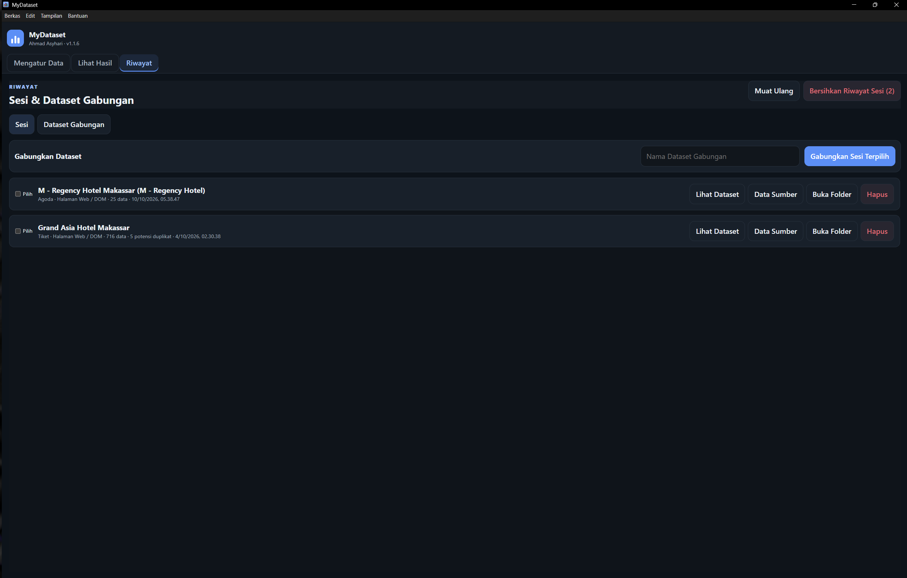
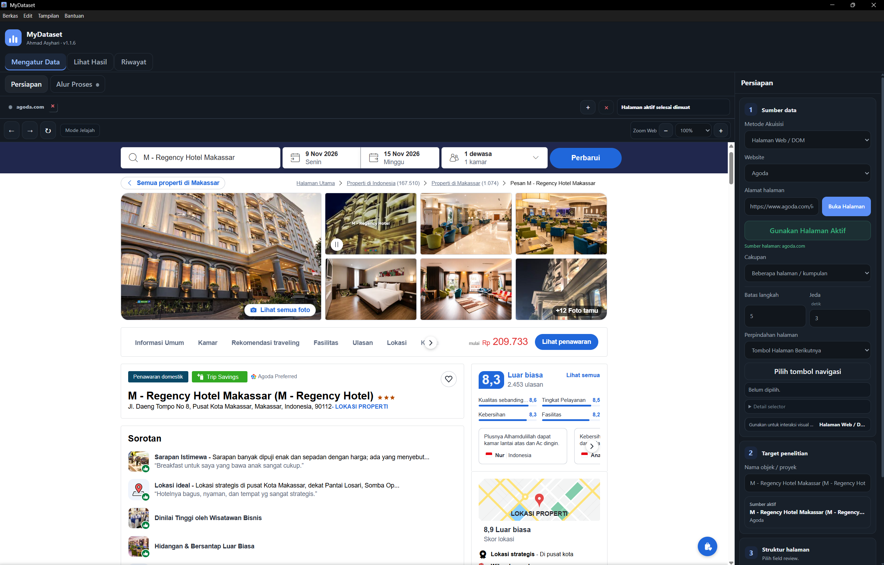
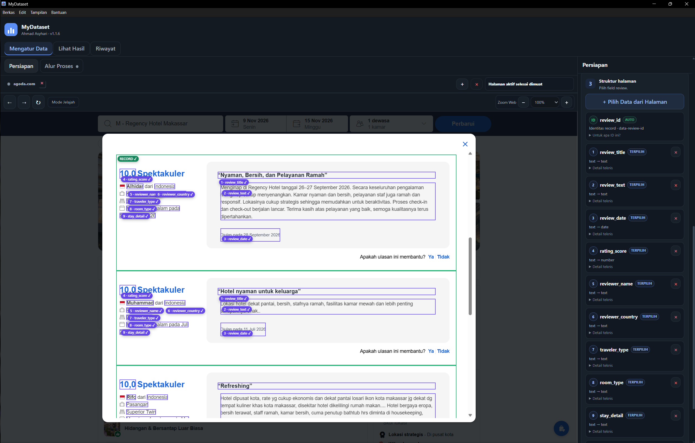
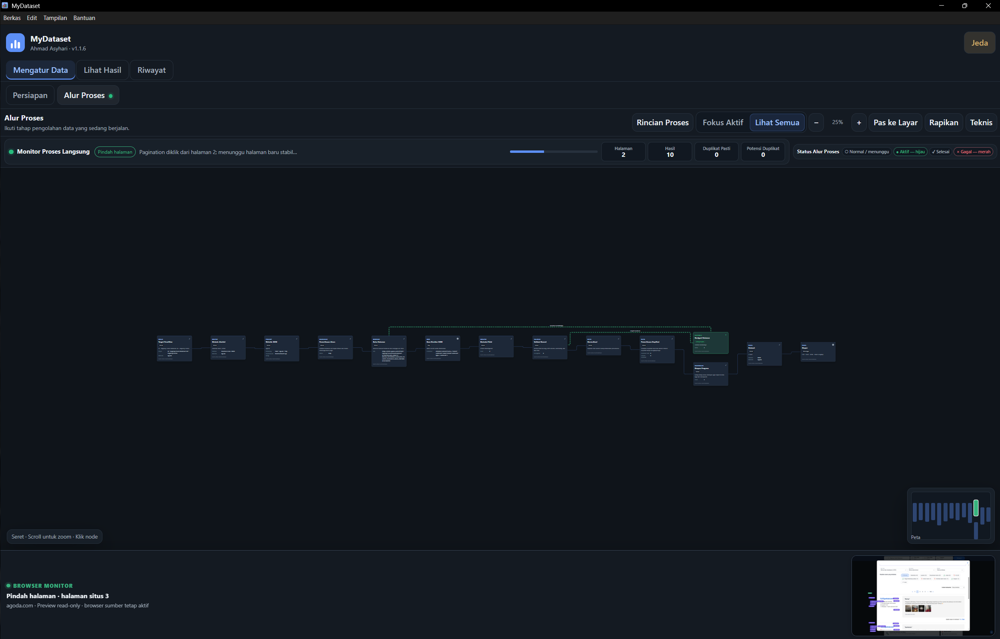
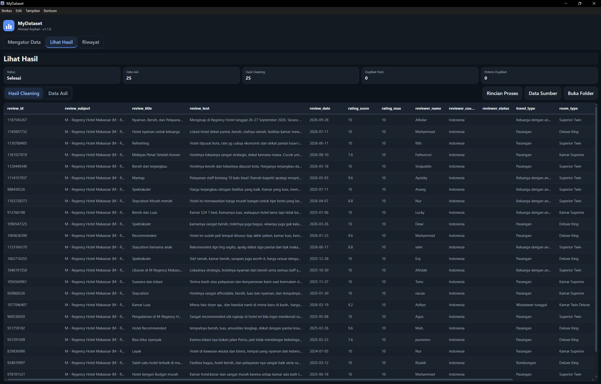
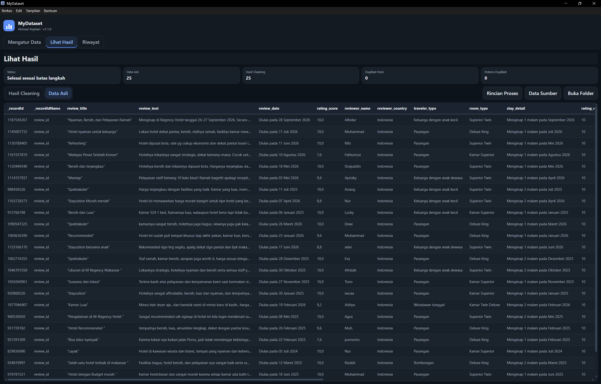

# MyDataset

MyDataset adalah aplikasi untuk mengumpulkan, membersihkan, mengaudit, menggabungkan, dan mengekspor data review web menjadi dataset terstruktur untuk kebutuhan analisis dan penelitian. MyDataset dirancang sebagai perangkat bantu pengumpulan dan pengolahan dataset. Pengguna bertanggung jawab memastikan pengambilan dan penggunaan data sesuai dengan ketentuan situs, izin akses, kebijakan privasi, serta kebutuhan etika penelitian yang berlaku. Aplikasi tidak dimaksudkan untuk melewati autentikasi, pembatasan akses, atau mekanisme proteksi website.

## Preview
<p>
  
  
  
  
  
  
  
</p>

## Fitur utama

- Pengambilan data melalui `HAR / Network` atau `Halaman Web / DOM` untuk sumber yang didukung
- Memiliki browser bawaan untuk pengambilan data `Halaman Web / DOM` namun untuk `HAR / Network` kamu harus melakukannya sendiri di browser yang kamu miliki
- Pemilihan field review secara visual pada mode `Halaman Web / DOM`
- Pagination multi-halaman dengan checkpoint dan audit proses
- Dapat menghasilkan data bersih (clean) dan data raw (mentah)
- Dapat mencegah adanya duplikat pada saat pengambilan data
- Dapat menggabungkan beberapa data yang sudah dikumpulkan menjadi dataset gabungan
- Memiliki normalisasi rating secara bawaan, data dari rating asli tetap ikut tersimpan
- Memiliki fitur riwayat run, status coverage, dan rincian proses
- Scraping aktif tanpa harus membuka aplikasi terus menerus (bisa berjalan di belakang layar

## Dukungan sumber dan metode

| Website | HAR / Network | Halaman Web / DOM | Adapter HAR utama |
|---|---:|---:|---|
| Traveloka | Ya | Tidak | `getReviews` |
| Tiket | Tidak | Ya | `verticalReview/internalReview` |
| Agoda | Tidak | Ya | `ReviewComments` |
| Trip | Tidak | Ya | `getHotelCommentInfo` |
| Booking | Ya | Tidak | GraphQL `ReviewList` |

## Metode 1 - HAR / Network
Metode ini hanya dapat digunakan pada data web `HAR / Network` Traveloka dan Booking 

Alur umum:

1. Buka halaman review pada Chrome atau Edge
2. Buka **DevTools → Network**
3. Aktifkan **Preserve log** bila diperlukan
4. Lakukan pagination sampai data yang diperlukan termuat
5. Simpan melalui **Save all as HAR with content**
6. Impor file `.har` ke MyDataset
7. Periksa website, objek, response, pagination, coverage, dan status hasil

MyDataset hanya dapat memproses response yang benar-benar terdapat di dalam HAR sesuai dengan kategori yang sudah di atur. File HAR yang berhasil diimpor tidak akan mengelola data diluar dari data yang aplikasi butuhkan.

## Metode 2 - Halaman Web / DOM
Metode DOM ini hanya tersedia untuk Tiket, Agoda, dan Trip

Alur umum:

1. Buka Aplikasi MyDataset lalu pilih **Halaman Web / DOM**
2. Pilih website target
3. Buka URL pada browser tertanam
4. Pilih field review secara visual
5. Periksa preview dan pemetaan field
6. Atur cakupan, batas langkah, jeda, dan metode pagination
7. Jalankan pengambilan


## Coverage dan keterbatasan sumber

MyDataset membedakan beberapa kondisi penyelesaian run, antara lain:
- `completed` artinya akhir sumber dapat diverifikasi.
- `completed_step_limit` artinya batas langkah pengguna tercapai; akhir sumber belum diklaim.
- `completed_source_limit` artinya sumber berhenti pada batas retrieval yang teramati.

Terkadang pada website, jumlah yang dilaporkan website tidak selalu sama dengan jumlah review yang benar-benar ditampilkan. Sebuah website dapat menyaring, menyembunyikan, atau membatasi review pada listing/endpoint tertentu sehingga ada beberapa komentar yang tidak dapat diakses. Jadi MyDataset tidak mengarang record yang tidak tersedia dari sumber dan hanya akan mengambil data yang dapat dilihat tersebut.

## Provenance dan identitas review
MyDataset mempertahankan informasi provenance agar data hasil tidak kehilangan konteks sumber.
Jika Tiket tidak menyediakan ID native untuk sebuah review, MyDataset dapat menghasilkan fallback deterministik :
```text
synthetic:tiket:<hash>
```
Prefix `synthetic:` sengaja dipertahankan agar ID tersebut tidak disalahartikan sebagai ID asli website.

## Audit Identitas
Audit identitas menyimpan jumlah native review ID, synthetic review ID dan missing review ID.

## Audit duplikat
- Duplikat hanya dipisahkan bila identitas yang cukup kuat menunjukkan record yang sama
- Kemiripan teks, reviewer, rating, atau tanggal diperlakukan sebagai Potensi Duplikat dan tidak dihapus otomatis
- Dataset Gabungan membedakan kandidat intra-session dan lintas sumber

## Rating dan normalisasi
- `rating_score` dan `rating_max` disimpan terpisah.
- Nilai rating asli tetap dipertahankan.
- Dataset Gabungan dapat menambahkan `rating_normalized` bila terdapat lebih dari satu skala rating.
- Target normalisasi lintas skala adalah 10.

## Identitas objek lintas sumber

Single-run mempertahankan nama sumber pada `source_object_name`.

Pada Dataset Gabungan:

- `canonical_object` dapat ditentukan manual melalui **Nama objek gabungan**;
- jika kosong, pencocokan otomatis dapat digunakan;
- `source_object_name` tetap menyimpan nama asli dari masing-masing website.

## Schema

Schema canonical:
```text
mydataset-review-v8
```

Schema standard:
```text
mydataset-review-standard-v8
```

#Field utama antara lain:

- `review_id`
- `canonical_object`
- `source_object_name`
- `review_provider`
- `review_title`
- `review_text`
- `review_original_text`
- `review_positive_text`
- `review_negative_text`
- `review_date`
- `rating_score`
- `rating_max`
- `rating_label`
- `reviewer / travel / room metadata`
- `stay_start_date`
- `stay_end_date`
- `stay_detail`
- `source_site`
- `source_url`
- `acquisition / session / run provenance`

### Persyaratan minimum untuk file exe/zip
- Windows 10/11 x64
"`Note : Jika file exe gagal dijalankan, coba download versi zip`"

### Persyaratan minimum untuk source code
- Windows 10/11 x64
- **Node.js 22.12.0 atau lebih baru**
- npm
- koneksi internet saat pemasangan dependency pertama

## Dimana pengolahan data tersimpan?
Lokasi data yang sudah diolah ```Documents\MyDataset\```
Folder tersebut menyimpan project, run, dataset individual, Dataset Gabungan, audit, checkpoint, dan metadata proses.

### Mau mengembangkan program ini? ikuti cara dibawah :
1. Clone atau download repository.
2. Buka folder MyDataset.
3. Jalankan `START-MYDATASET.bat`
maka aplikasi akan berjalan dengan normal

## Membuat aplikasi dari file yang sudah dikembangkan ke Windows EXE
1. Clone/download repository.
2. Jalankan `BUILD-EXE-WINDOWS.bat`.
3. Tunggu `npm ci` dan `electron-builder` selesai.
4. EXE akan dibuat pada `dist\MyDataset-v1.1.6-Windows-x64.exe`
Hasil build adalah **portable Windows x64 EXE**. Pengguna file EXE tidak perlu menginstal Node.js secara terpisah.

## MyDataset Capture (Additional / Jika diperlukan)
Folder `chrome-extension` disertakan sebagai pendamping capture historis/opsional. Workflow Network utama tetap **HAR with content**.

## Struktur repository
```text
MyDataset/
├── src/
│   ├── core/
│   ├── engine/
│   ├── shared/
│   └── ui/
├── chrome-extension/
├── build/
├── .gitignore
├── BUILD-EXE-WINDOWS.bat
├── START-MYDATASET.bat
├── CHANGELOG.md
├── LICENSE
├── package.json
├── package-lock.json
└── README.md
```

## Lisensi
MyDataset dirilis dengan **MIT License**. Lihat [LICENSE](LICENSE).
